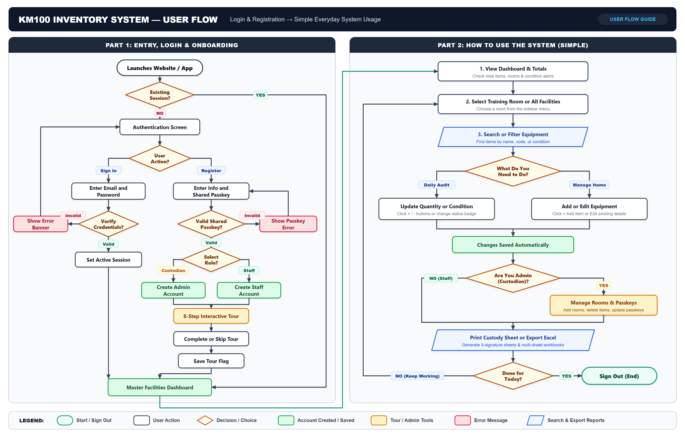
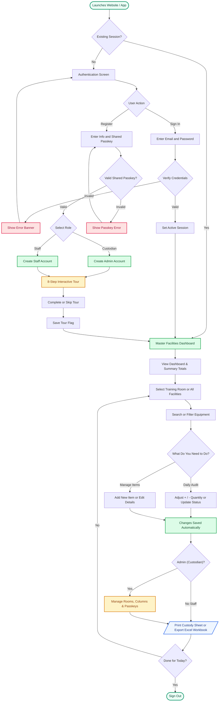

# KM100 Inventory Management System: User Flow Flowchart

This document contains the complete, easy-to-read **User Flow Flowchart** for the **KM100 Skills and Training Center, Inc.** Property Custody & Inventory Management System.

- **Part 1 (Entry, Login & Onboarding)**: Matches the full authentication flow from launching the app, signing in or registering with a shared passkey (Custodian or Staff), taking the 8-step interactive tour, and landing on the **Master Facilities Dashboard**.
- **Part 2 (How to Use the System — Simple)**: Continues cleanly from the dashboard into simple daily operations: picking a room, searching/filtering equipment, adjusting stock quantities or condition badges, managing rooms/passkeys (Admin only), printing custody sheets / exporting Excel / printing QR stickers, and signing out.

---

## User Flow Flowchart

> **Exports**: [Ultra-HD PNG (3840×2440)](./flowcharts/user-flow-flowchart.png) • [Lossless Vector SVG](./flowcharts/user-flow-flowchart.svg) • [Mermaid Source (`ims-user-flow.mmd`)](./ims-user-flow.mmd)

---

### Mermaid Source Definition (`docs/ims-user-flow.mmd`)

