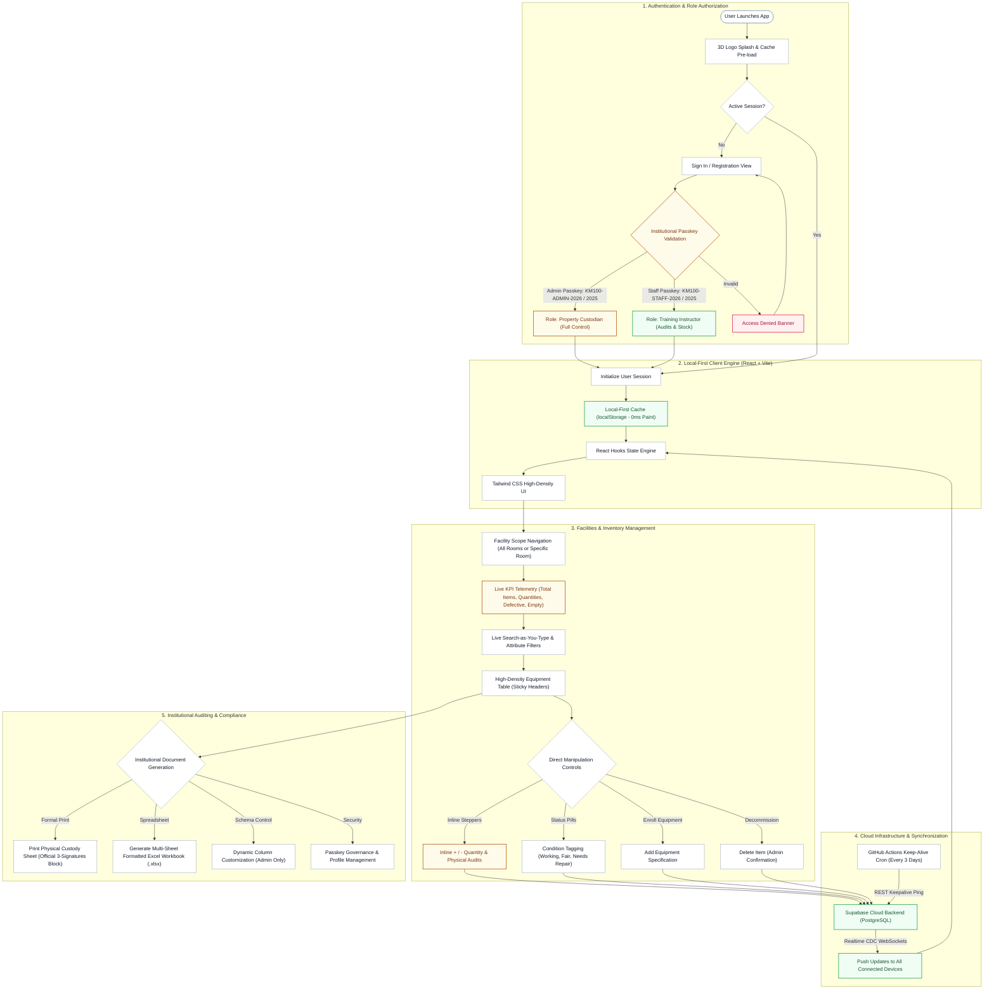
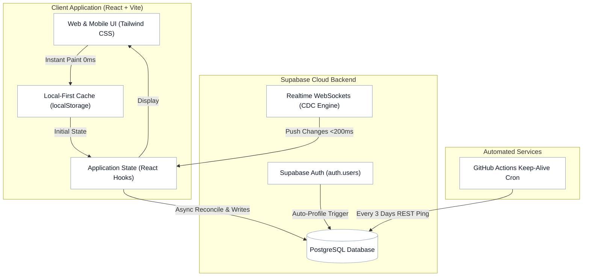
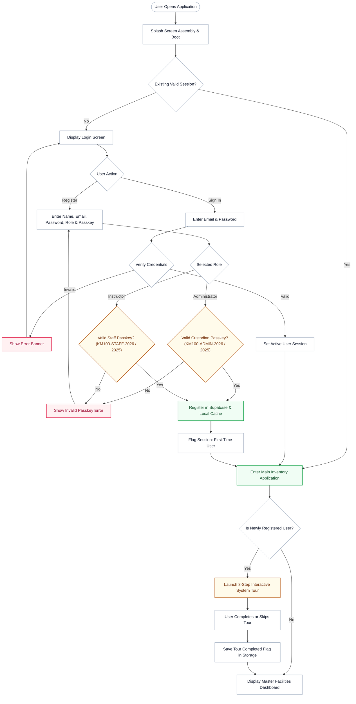
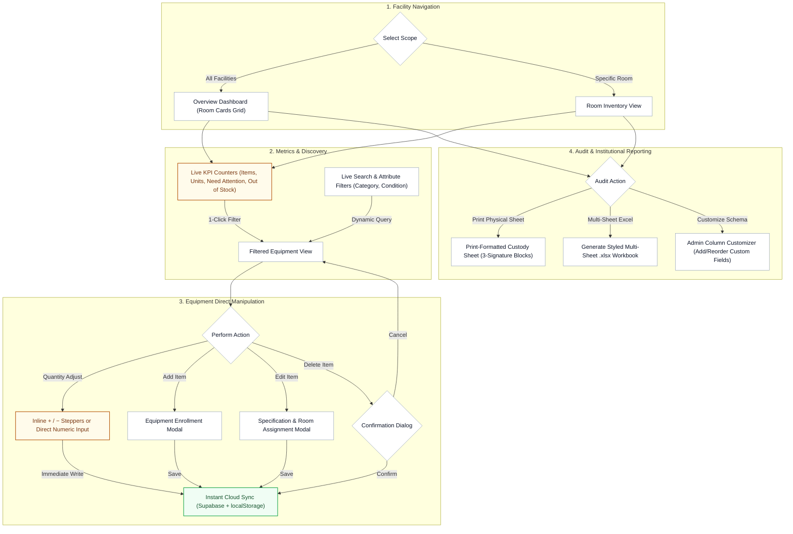
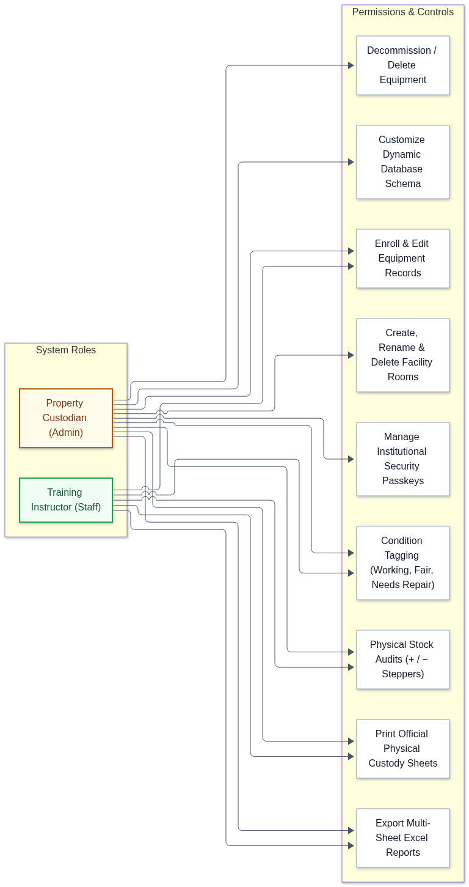
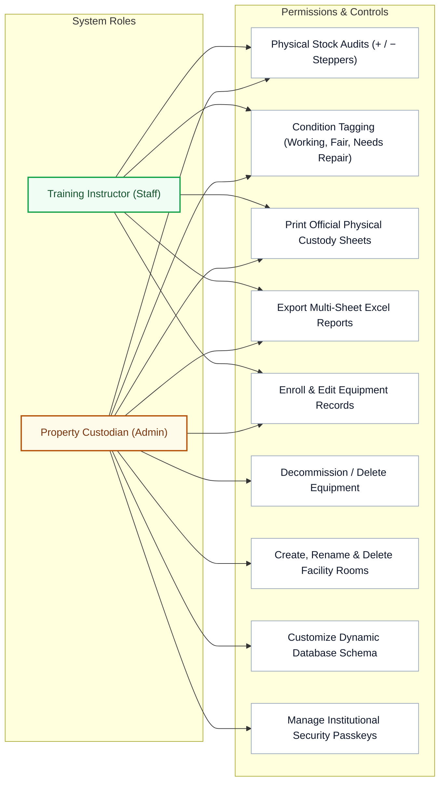

# KM100 Inventory Management System: Architecture & Workflow Diagrams (Light Mode)

This document provides light-mode architectural blueprints, role-based access control, and operational lifecycles for the **KM100 Skills and Training Center, Inc.** Property Custody & Inventory Management System. All diagrams are rendered as high-resolution PNG images with an **opaque pure white background** in [`docs/flowcharts/`](./flowcharts/).

---

## 0. Master System Flowchart (End-to-End Operational Overview)

> **Export**: [Download / View PNG (00-master-system-flowchart.png)](./flowcharts/00-master-system-flowchart.png)

View Mermaid Source Definition

---

## 1. High-Level System Architecture & Data Flow

> **Export**: [Download / View PNG (01-architecture-data-flow.png)](./flowcharts/01-architecture-data-flow.png)

View Mermaid Source Definition

---

## 2. Authentication & First-Time Onboarding Flow

> **Export**: [Download / View PNG (02-authentication-onboarding-flow.png)](./flowcharts/02-authentication-onboarding-flow.png)

View Mermaid Source Definition

---

## 3. Core Operational Inventory Lifecycle

> **Export**: [Download / View PNG (03-inventory-lifecycle-flow.png)](./flowcharts/03-inventory-lifecycle-flow.png)

View Mermaid Source Definition

---

## 4. Institutional Role & Permission Matrix

> **Export**: [Download / View PNG (04-roles-permission-matrix.png)](./flowcharts/04-roles-permission-matrix.png)

View Mermaid Source Definition

