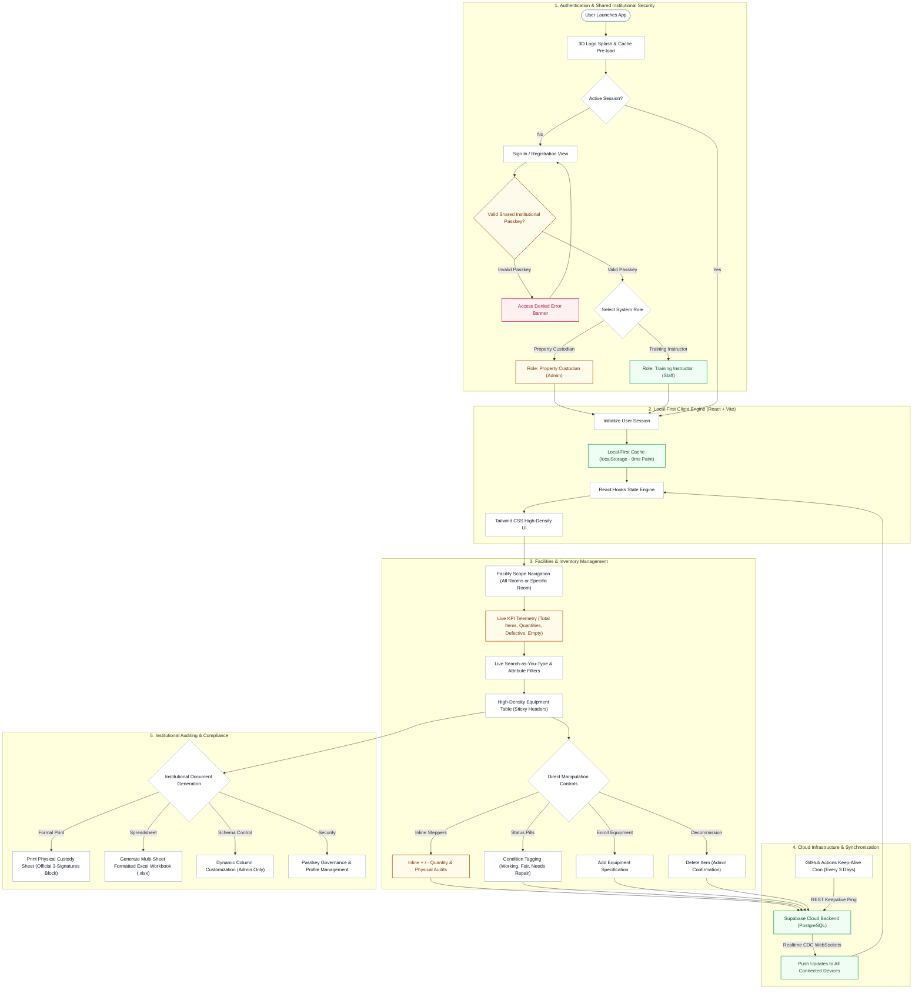
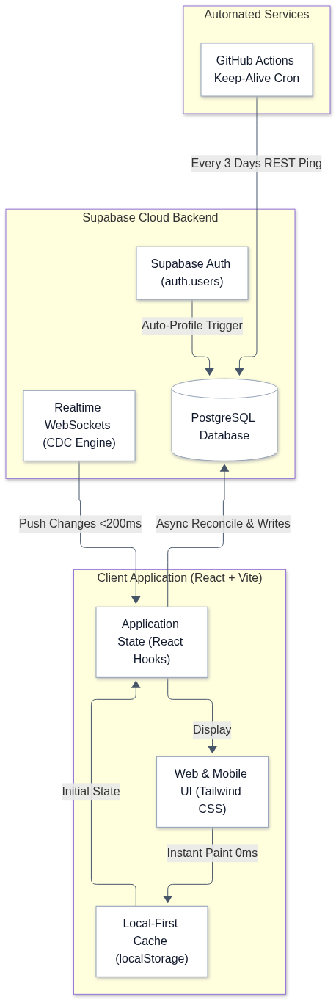
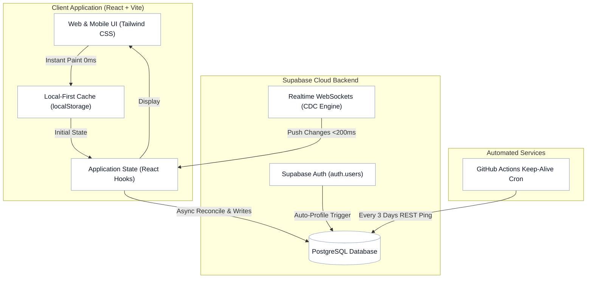
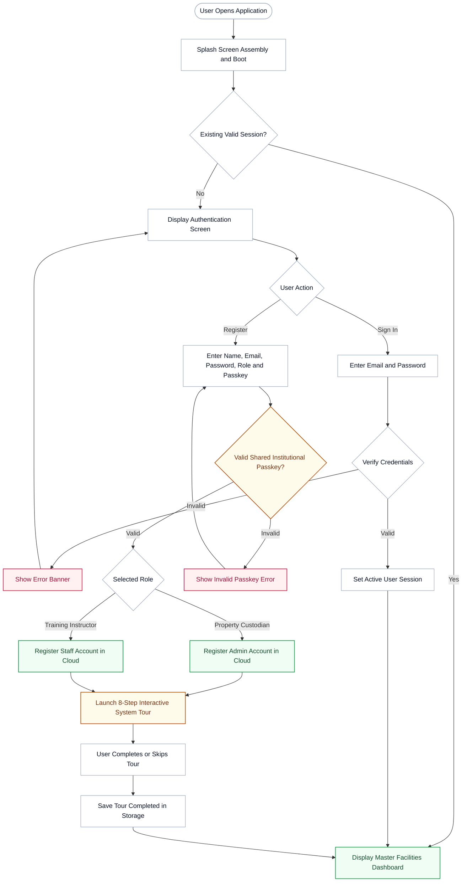
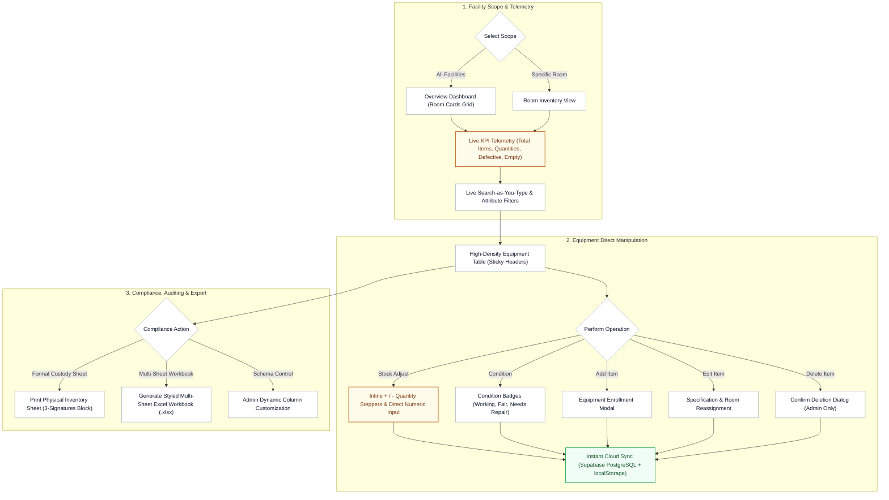
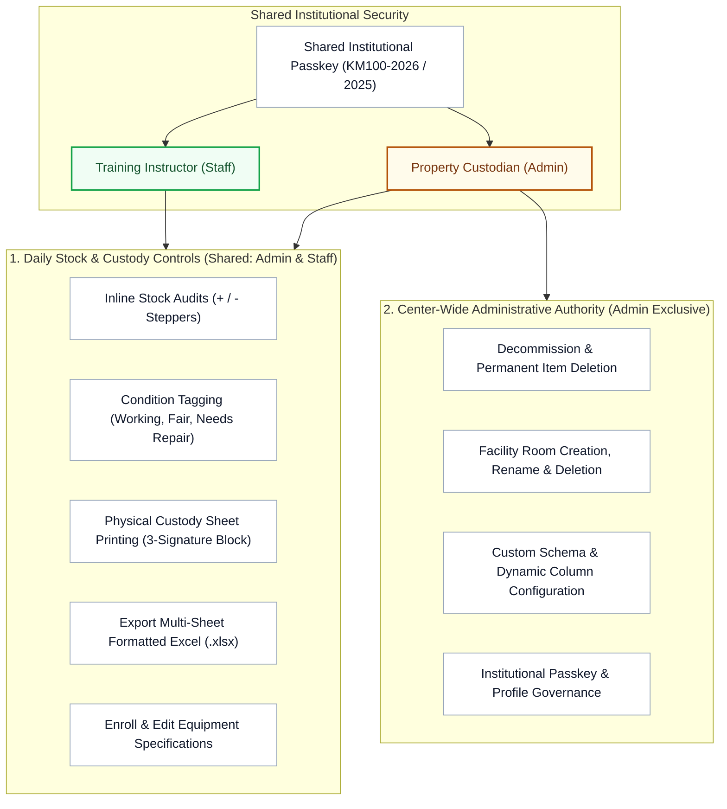

# KM100 Inventory Management System: Architecture & Workflow Diagrams (Light Mode)

This document provides light-mode architectural blueprints, role-based access control, and operational lifecycles for the **KM100 Skills and Training Center, Inc.** Property Custody & Inventory Management System.

All diagrams are formatted to fit standard **Short Bond Paper (Letter: 8.5" × 11")** and rendered as high-resolution PNG images with an **opaque solid pure white background** in [`docs/flowcharts/`](./flowcharts/).

> 🖨️ **Print-Ready Bond Paper Document**: Open [`docs/KM100_Inventory_Flowcharts_Bondpaper.html`](./KM100_Inventory_Flowcharts_Bondpaper.html) in your browser to print all 5 flowcharts on standard bond paper sheets or save as a multi-page PDF.

---

## 0. Master System Flowchart (End-to-End Operational Lifecycle)

> **Export**: [Download / View PNG (00-master-system-flowchart.png)](./flowcharts/00-master-system-flowchart.png) • **Print Layout**: Fits Short Bond Paper (8.5" × 11")

View Mermaid Source Definition

---

## 1. High-Level System Architecture & Data Flow

> **Export**: [Download / View PNG (01-architecture-data-flow.png)](./flowcharts/01-architecture-data-flow.png) • **Print Layout**: Fits Short Bond Paper (8.5" × 11")

View Mermaid Source Definition

---

## 2. Authentication & First-Time Onboarding Flow (Shared Passkey)

> **Access Governance**: Property Custodians (Admin) and Training Instructors (Staff) share the same institutional passkey. The user selects their organizational role during enrollment.

> **Export**: [Download / View PNG (02-authentication-onboarding-flow.png)](./flowcharts/02-authentication-onboarding-flow.png) • **Print Layout**: Fits Short Bond Paper (8.5" × 11")

View Mermaid Source Definition

---

## 3. Core Operational Inventory Lifecycle

> **Export**: [Download / View PNG (03-inventory-lifecycle-flow.png)](./flowcharts/03-inventory-lifecycle-flow.png) • **Print Layout**: Fits Short Bond Paper (8.5" × 11")

View Mermaid Source Definition

---

## 4. Institutional Role & Permission Matrix (Shared Passkey Architecture)

> **Security Governance**: Admin and Staff share the same institutional passkey to unlock the system. Role assignment dictates execution permissions between daily custody audits and center-wide administrative controls.

> **Export**: [Download / View PNG (04-roles-permission-matrix.png)](./flowcharts/04-roles-permission-matrix.png) • **Print Layout**: Fits Short Bond Paper (8.5" × 11")

View Mermaid Source Definition

